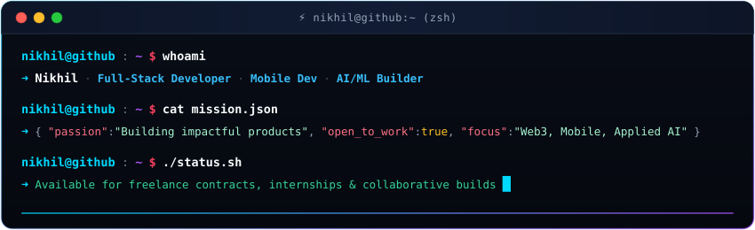

<!-- Waving Gradient Header Banner -->

<!-- Modern Interactive Terminal Window Header -->

 

<!-- Modern Animated Dynamic Punchline -->

  

<!-- Modern Sleek Social Badges -->

  

<!-- Profile Visitors Counter -->

---

### `nikhil@github ~ $ ./contributions.sh`

## `nikhil@github ~ $ cat about-me.md`

I'm **Nikhil**, a developer and product builder who enjoys taking ideas from a rough sketch to useful software. I build across **web, mobile, and AI/ML**, contribute to open source, and work as a freelancer.

- 🧩 **Full-stack:** MERN, TypeScript, REST APIs, SQL, PostgreSQL
- 📱 **Mobile:** React Native and Flutter
- 🤖 **AI/ML:** AI-powered applications, ML experiments, and developer tools
- 🚀 **Product building:** Prototyping, shipping, deployment, and iteration
- 🌱 **Open source:** Documentation, bug fixes, tests, and collaborative development
- 💼 **Freelance:** Turning product ideas into practical software
- 🏢 **Experience:** Former intern at **Eglogics**, a Noida-based company

> `BUILD → LEARN → CONTRIBUTE → SHIP → REPEAT`

## `nikhil@github ~ $ ls tech-stack/`

 

**Frontend & UI Development**  
 

  

**Backend, APIs & Databases**  
 

  

**Mobile Development**  
 

  

**AI / ML & Data Science**  
 

  

**Languages, DevOps & Tools**  
 

 

## `nikhil@github ~ $ ./stats.sh`

<table>
<tr>
<td width="50%" valign="top"></td>
<td width="50%" valign="top"></td>
</tr>
<tr>
<td colspan="2" valign="top"></td>
</tr>
</table>

## `nikhil@github ~ $ ./contributions-3d.sh`

## `nikhil@github ~ $ find ./projects -maxdepth 1`

I like building software that combines practical engineering with real-world usefulness:

| Focus | What I build |
|---|---|
| 🌐 **Full-stack products** | Modern web apps, APIs, authentication, database design, and deployment |
| 📱 **Mobile apps** | Cross-platform applications with React Native and Flutter |
| 🤖 **AI-powered tools** | AI/ML experiments and tools that improve developer workflows |
| 🧰 **Automation** | Scripts, integrations, data workflows, and productivity tools |
| 🌍 **Open source** | Useful documentation, bug fixes, tests, and feature contributions |

Explore my latest work in [my repositories](https://github.com/NIKHIL2K5?tab=repositories).

## `nikhil@github ~ $ ./links.sh`

  

### `printf("Thanks for visiting. Let's build something meaningful.\\n");`

